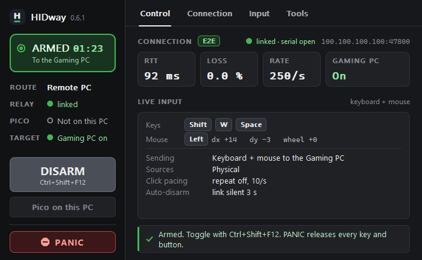

# HIDway+

[](https://github.com/wannabexaker/HIDway-Plus/actions/workflows/ci.yml)

**Remote keyboard and mouse over a real USB HID interface.**

HIDway+ lets you control a computer from another PC across the network, while
the target machine sees nothing but an ordinary USB keyboard and mouse. A
Raspberry Pi Pico is that keyboard and mouse; a small relay on a Raspberry Pi
forwards your input to it. It is, in effect, a build-it-yourself networked KVM
for keyboard and mouse. Picture and sound come from a separate application
such as Moonlight/Sunshine or AnyDesk.

```
┌──────────────────────┐   UDP over a private   ┌────────────────────────┐
│  Windows PC          │   network (Tailscale)  │  Raspberry Pi (relay)  │
│  hidway-client  ─────┼───────────────────────▶│  hidwayd               │
│  (captures input)    │                        │  (ordered, fail-safe)  │
└──────────────────────┘                        └───────────┬────────────┘
                                                            │ UART
                                                ┌───────────▼────────────┐
                                                │  Raspberry Pi Pico     │
                                                │  USB keyboard + mouse  │
                                                └───────────┬────────────┘
                                                            │ USB
                                                ┌───────────▼────────────┐
                                                │  Target PC             │
                                                │  no driver, no agent   │
                                                └────────────────────────┘
```

<p align="center">
  
</p>

This is the continuation of the earlier HIDway project
([HIDway-beta](https://github.com/wannabexaker/HIDway-beta), releases up to
v0.3.0). Version numbers carry on from there: the first release here is v0.4.0.

## Why

Some applications and games only accept input that arrives through a real
hardware device and ignore input injected by software (remote-desktop tools,
`SendInput`, virtual HID drivers). HIDway+ bridges that gap honestly: the input
you make is reproduced by a physical USB HID device on the target, exactly as
if a keyboard and mouse were plugged in locally.

## What it does

**Two routes**

| Route | Where HIDway runs | What it forwards |
|---|---|---|
| **Remote PC** | on the PC you sit at | its keyboard, mouse, touchpad and, if you allow it, input from remote-control software, to the Gaming PC |
| **Gaming PC** | on the PC the Pico is plugged into | virtual input arriving there (Moonlight, AnyDesk) back through the Pico, as real USB input on that same PC |

**Control**
- ARM / disarm with a button, a floating badge, the tray menu or a global hotkey (`Ctrl+Shift+F12`); PANIC releases everything at once (`Ctrl+Alt+Shift+End`).
- **Pico on this PC**: one click selects the Gaming PC route after checking that the Pico is really connected there. It never arms.
- Connection status in the window: relay reachability, round-trip time, loss, send rate, whether the target is on, and Wake-on-LAN when the relay is set up for it.

**Input**
- Keyboard and mouse can be forwarded independently; sources are chosen explicitly: Physical, Touchpad, Virtual / remote.
- Each source owns its held keys and buttons, so one source's release never clears another's hold.
- A limit for virtual clicks per second and an optional hold-to-repeat per button and source.

**Tools**
- **Input Monitor**: names your devices, counts presses and releases per device, and shows what Windows reports for each event.
- **Recording and replay**: record a short sequence in the Monitor and replay it through the Pi and Pico after confirmation, for testing without a second person.
- **Setup wizard** (`HIDway-Setup.exe`): installs the Windows tools and guides the network, the Pi relay and the Pico firmware.
- **Check for updates**: downloads a verified release from this repository, installs it for both Windows tools and keeps the previous version for rollback.

## Design principles

- **A relay of your input, not an input generator.** What reaches the target is
  what a selected source produced. The exceptions are explicit and off by
  default: hold-to-repeat, and replay of a recording you made and confirmed.
- **Honest device identity.** The Pico enumerates as a plain HID keyboard and
  mouse under its own name. It never imitates another vendor and contains no
  detection-evasion or hiding mechanism.
- **Fail-safe everywhere.** A lost link, a timeout, a full queue, a locked
  session or a crash ends in *all keys and buttons released*. A key cannot stay
  stuck on the target.
- **Late input is dropped, not replayed.** Key and button changes are kept in
  order through small bounded queues; anything that waited too long is
  cancelled with a release instead of arriving late.
- **Nothing happens by itself.** No automatic ARM, no background update timer,
  no automatic elevation, no telemetry.

## Responsible use

HIDway+ is a general-purpose remote-input device. You are responsible for
complying with the terms of service and rules of any software, game or service
you use it with. Some online games prohibit input from devices they consider
non-standard, regardless of intent; HIDway+ does not and will not attempt to
hide what it is. Use it where you are permitted to.

## Components

| Part | Runs on | Purpose |
|---|---|---|
| `client/` | Windows | The window, badge and tray; capture, source ownership and the UDP sender |
| `tools/input-monitor/` | Windows | Device inventory, counters, recording |
| `tools/setup/` | Windows | Setup wizard, CLI setup, updater |
| `tools/probe/` | Windows | `hidway-probe`: reachability and round-trip time without arming |
| `relay/` | Raspberry Pi (Linux) | `hidwayd`: receives state, forwards it over UART, releases on silence; installer and updater |
| `firmware/` | Pico, Pico W, Pico 2, Pico 2 W | USB HID keyboard + mouse (TinyUSB), watchdog |
| `common/` | shared | Protocol, crypto, framing, key mapping, input-state logic; plain C11 with host tests |
| `tests/` | host | Unit tests, relay fail-safe tests, installer and updater tests |

The transport is meant for a private network such as
[Tailscale](https://tailscale.com/), so the relay is never exposed to the
public internet. For paths that are not private end to end, every packet can
additionally be sealed with XChaCha20-Poly1305 and a shared key; see
[relay operations](docs/RELAY.md#end-to-end-encryption-optional) and
[SECURITY.md](SECURITY.md).

## Install

1. Download `HIDway-vX.Y.Z-windows.zip` from
   [Releases](https://github.com/wannabexaker/HIDway-Plus/releases/latest) and
   **extract all of it** to a normal local folder (not OneDrive).
2. Run `HIDway-Setup.exe`. The wizard installs HIDway and the Input Monitor
   together, then walks through the private network, the Raspberry Pi relay
   (over SSH, in a visible terminal) and the Pico firmware (BOOTSEL).
3. Install on both PCs if you use both routes. Skip the Pi and Pico steps where
   they are already done.

The binaries and scripts are not signed, so Windows may show its publisher
prompt. Details, wiring and prerequisites: [installation](docs/INSTALLATION.md)
and [relay operations](docs/RELAY.md).

## Daily use

1. Open HIDway and check that the relay is reachable.
2. Pick the route once: Remote PC on the PC you sit at, or **Pico on this PC**
   on the PC with the Pico.
3. ARM. Your selected input now acts on the target. Disarm with the same
   button or hotkey; PANIC if anything looks wrong.

While armed on the Remote PC route, the badge holds the focus, so system
shortcuts go to the target too. `Ctrl+Alt+Del` and `Win+L` are reserved by
Windows and stay local. Anything that takes the focus away, locks the PC or
drops the link disarms and releases. For an elevated game on the Gaming PC,
start HIDway as administrator yourself; it never elevates on its own.

## Updates and versions

- A release is an annotated `vX.Y.Z` tag on `main`. CI builds and tests
  Windows, Linux and firmware, and the release workflow publishes
  `HIDway-vX.Y.Z-windows.zip`, the four firmware files and `SHA256SUMS.txt`.
- **Updates** in HIDway (or **Check for updates** in the Monitor and the Start
  menu) checks this repository only, verifies size, digest, archive paths and
  the internal manifest, and installs both Windows tools. Settings, labels and
  recordings are kept. Nothing is downloaded or installed automatically.
- The Raspberry Pi relay follows the same tags with its own nightly check and
  rollback (`hidway-status`, `sudo hidway-update`).
- The updater replaces the installation folder as a whole. Close HIDway, the
  Monitor and any terminal or editor opened in that folder first.

Full contract, recovery and trust limits: [updates](docs/UPDATES.md).

## Build

Windows client, tools and shared tests (Visual Studio developer terminal with
the C++ workload, CMake and Ninja):

```powershell
git clone https://github.com/wannabexaker/HIDway-Plus.git
cd HIDway-Plus
cmake -S . -B .scratch/host -G Ninja -DCMAKE_BUILD_TYPE=Release -DCMAKE_COMPILE_WARNING_AS_ERROR=ON
cmake --build .scratch/host
ctest --test-dir .scratch/host --output-on-failure
```

Firmware (Pico SDK and Arm GNU toolchain; choose the board explicitly):

```powershell
cmake -S firmware -B .scratch/pico2 -G Ninja -DPICO_BOARD=pico2 -DHIDWAY_T0=OFF
cmake --build .scratch/pico2
```

Relay and its tests, on Linux:

```bash
make -C relay hidwayd check failsafe
bash tests/deploy/test_install.sh
```

A Windows package like the released one:
`tools/package-windows.ps1 -BuildDir <build> -FirmwareDir <folder with the four UF2 files> -OutDir <output> -Version <label>`.
Local builds, packages and working files belong in the ignored `.scratch/` and
`out/` folders.

## Documentation

| Topic | Document |
|---|---|
| Install and first use | [INSTALLATION](docs/INSTALLATION.md) |
| Raspberry Pi relay: install, status, releases, wiring, Wake-on-LAN | [RELAY](docs/RELAY.md) |
| Windows updates, release contract, versioning | [UPDATES](docs/UPDATES.md) |
| Input sources, routes and their limits | [INPUT_SOURCES](docs/INPUT_SOURCES.md) |
| Input Monitor, recording and replay | [INPUT_MONITOR](docs/INPUT_MONITOR.md), [RECORDING_AND_SETUP](docs/RECORDING_AND_SETUP.md) |
| How it is built | [ARCHITECTURE](docs/ARCHITECTURE.md) |
| What was tested, and what was not | [VALIDATION](docs/VALIDATION.md), [INPUT_TESTING](docs/INPUT_TESTING.md) |
| Trust boundaries and known limits | [SECURITY](SECURITY.md) |
| Plans | [ROADMAP](docs/ROADMAP.md) |

## Limits worth knowing

- USB keyboard output is six keys plus modifiers (6KRO).
- UDP has no per-key acknowledgment: queues protect what arrived, not what was
  lost on the way. A stall releases instead of replaying.
- Windows cannot always tell which device or program produced an event.
  Injection flags and device names are hints, not identities.
- On the Gaming PC route, programs that read Raw Input can still see the
  original remote input next to the Pico's.
- Secure Desktop, the logon screen and elevated programs follow Windows'
  integrity rules; ordinary hooks do not reach them.
- Development USB IDs are `CAFE:4877`.

## License

[MIT](LICENSE). Vendored components keep their own notices.
